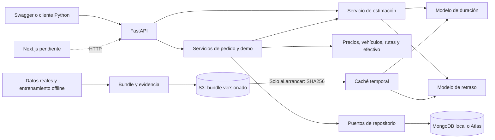

# ARCHITECTURE — Arquitectura del Asistente de Delivery Económico

## Arquitectura actual

La aplicación ejecutable es una API FastAPI con servicios de dominio, MongoDB
para datos operativos y dos modelos v2 cargados desde un bundle propio de S3.
Docker Compose reproduce la demo local; Atlas es la alternativa de base en la
nube ya verificada. La infraestructura ECS/Fargate está creada y el contenedor
cloud sirve la API con los dos modelos S3 y persistencia Atlas ya verificados.
Next.js aún no está implementado. Los detalles de versiones previas explican compatibilidad,
no cambian el contrato v2 descrito en esta sección.



### Responsabilidades y datos

| Componente | Responsabilidad y límite |
|---|---|
| `delivery.api` | Validar entrada, componer dependencias, llamar servicios y traducir errores. |
| `delivery.services` | Estimar y coordinar reglas/persistencia; no entrena modelos durante solicitudes. |
| `delivery.domain` | Entidades inmutables, estados y reglas con entradas/configuración explícitas. |
| `delivery.ports` y `delivery.adapters` | Aislar repositorios, MongoDB, S3 y carga del modelo del resto del producto. |
| MongoDB | Negocios, repartidores, pedidos/eventos, asignaciones y efectivo. No guarda datasets o pesos. |
| S3 `ml-kodigo-resources`, `us-east-1` | Bundles y documentación privados; `datasets/` contiene metadatos/licencia, no CSV redistribuidos. |
| `ml/` y notebooks | Datos reales, transformaciones, experimentos y evaluación offline. No usan registros de demo para entrenar. |

En Compose la base es una réplica de un nodo con volumen persistente y sin
puerto publicado; la API se expone en `127.0.0.1`. En ejecución nativa,
`MONGODB_URI`/`MONGODB_DATABASE` pueden seleccionar Atlas. No se escribe a ambas
bases a la vez. Se prepara/verifica el esquema antes de habilitar la persistencia.

### Contratos usados por la demo actual

| Ruta | Entrada/resultado |
|---|---|
| `POST /predict/delivery` | Fecha ISO con zona, origen/destino y plazo positivo; devuelve minutos, probabilidad de retraso, distancia, versión, fuente y limitaciones. |
| `POST /demo/deliveries` | Datos/configuración explícitos con `simulated=true` e IDs `demo-`; devuelve el recorrido completo y su recibo. Solo con `DELIVERY_DEMO_ENABLED=1`. |
| `GET /orders`, `GET /orders/{order_id}` | Consulta de registros e historial persistidos. |
| `/businesses`, `/couriers` | CRUD de catálogos, referencias y disponibilidad protegidas. |
| `POST /orders/{order_id}/transitions` | Estado esperado/destino; no admite omitir validaciones de cotización o asignación. |
| `GET /health`, `POST /predict` | Compatibilidad v1: proceso/disponibilidad y predicción solo temporal, respectivamente. |

El esquema completo se publica en `/openapi.json` y `/docs`. Una entrada
inválida produce 422, una referencia ausente 404, un conflicto 409 y un modelo
no disponible 503. Los errores no devuelven credenciales o detalles internos.
El campo `model_available` de health describe v1; la respuesta de inferencia
v2 muestra `model_source=s3` o `local`.

### Arranque e inferencia

Con `DELIVERY_MODEL_V2_DIR` explícito se usa un bundle local. Si está vacío,
las variables `DELIVERY_MODEL_V2_MANIFEST_KEY`, `_SHA256` y `_SIZE` fijan el
manifiesto S3. Se verifican hash, lista exacta, versión y entorno antes de
cargar `eta.pkl` y `risk.pkl`. La API cierra el cliente S3 y sirve los pesos
desde memoria; la caché se elimina al apagar o fallar. No hay descargas por
solicitud, reentrenamiento automático o fallback a pesos distintos.

El complemento `compose.s3.yaml` monta el perfil de desarrollo solo en lectura.
En un futuro despliegue se usarán variables y rol IAM con lectura del prefijo;
no se montan credenciales personales. El bucket existente no se recrea.

### Flujo y garantías

La demo compone solicitud, estimación v2, desglose de precios, aceptación
simulada, confirmación, reserva de repartidor, recogida, entrega, cobro y entrega
de efectivo. La tarifa proviene de configuración y distancia, no del modelo.
La ruta es una sugerencia abierta geométrica, no navegación vial. La duración
estimada no se transforma en un viaje observado.

MongoDB conserva estados/eventos con UTC y precisión monetaria Decimal128;
versiones/CAS evitan cambios sobre snapshots obsoletos. La reserva de pedidos
y ocupación del repartidor usan una transacción; el grupo se libera solo al
completarse las entregas. Esto no convierte todo el recorrido en una única
transacción: una interrupción conserva los pasos aceptados. El efectivo es
simulado y su historial está separado del estado logístico.

El recibo `data/reports/presentation/demo_result.json` conserva entradas,
cotización/modelo, ruta, mensajes e historiales. La cotización completa no se
almacena en una nueva colección ni se ofrece reanudación por pasos. La
aceptación de la demo no habilita los validadores de los endpoints generales.

La [metodología y resultados](DATA_ML.md#resultados-vigentes) explican el alcance
experimental; el [README](../README.md) contiene los comandos de ejecución.

## Stack utilizado y previsto

| Capa | Tecnología | Función |
|---|---|---|
| Dominio y servicios | Python 3.9+ | Entidades, casos de uso, validación |
| API | FastAPI + Pydantic | `/health`, `/predict`, OpenAPI; otros contratos a acordar |
| BD operacional | MongoDB | Pedidos, negocios, repartidores, estados, eventos, índices/validaciones |
| Objetos | AWS S3 con `boto3` | Datasets, modelos, documentos |
| ETL | Pandas, Dask, PySpark local | Transformaciones comparables y benchmarks |
| ML/DL | scikit-learn + PyTorch | Baseline, 3 familias ML y MLP pequeña |
| Demo | Next.js | Cuatro vistas y chat simulado |
| Local | Docker / Docker Compose | Demo reproducible |
| Infraestructura | Terraform + AWS | Provisionar recursos nuevos de despliegue con permiso |
| CI/CD | GitHub Actions | Tests/build/deploy, en tareas posteriores |

No incluir Kubernetes, colas, microservicios ni servicios administrados caros sin necesidad demostrable.

## Límites de componentes y dependencias — T03

Se propone un backend modular dentro de un solo paquete Python, `delivery`.
La API y el procesamiento offline comparten únicamente contratos y artefactos
documentados; no hace falta separar el backend en varios servicios desplegables.

| Componente | Responsabilidad | Límite |
|---|---|---|
| `delivery.domain` | Entidades, unidades y reglas puras de negocio | No importa FastAPI, MongoDB, boto3 ni bibliotecas de entrenamiento. No fija parámetros comerciales pendientes. |
| `delivery.services` | Coordinar pedidos, cotizaciones, asignaciones y efectivo simulado | Usa dominio y puertos; no conoce documentos MongoDB ni claves S3 concretas. |
| `delivery.ports` | Describir operaciones de persistencia, archivos e inferencia | Contratos Python simples basados en tipos del dominio; sin clientes de SDK ni tipos HTTP. |
| `delivery.adapters` | Implementar puertos con MongoDB, S3 y el modelo validado | Traduce datos externos al contrato interno; no decide tarifas ni entrena durante una solicitud. |
| `delivery.api` | Validar solicitudes/respuestas, componer dependencias y traducir errores a HTTP | Invoca servicios; no contiene reglas comerciales ni acceso directo desde los handlers a MongoDB/S3. |
| `ml/data` | Adquisición y transformaciones reproducibles | Trabaja con archivos de procedencia verificada; no consume pedidos simulados como etiquetas reales. |
| `ml/experiments` | Entrenar, evaluar y exportar pipeline y manifiesto | Produce artefactos versionados para inferencia; no depende de la API ni de MongoDB. |
| `frontend` | Presentar chat y paneles Next.js | Consume HTTP/JSON; no calcula una tarifa oficial en paralelo al backend ni accede a MongoDB/S3 con credenciales. |
| `infra` | Contenedores y recursos de despliegue cuando corresponda | Sin lógica de negocio; referencia el bucket existente y no se ejecuta en T03. |

Las dependencias de código apuntan hacia el dominio: los servicios usan puertos,
los adaptadores los implementan y la composición de la API los conecta. Los
adaptadores no se invocan entre sí para coordinar el negocio. El motor de
cotización recibe un resultado del puerto de predicción, sin importar código
de entrenamiento. La API carga una versión validada del pipeline al iniciar el
servicio o mediante un mecanismo explícito de carga; no la descarga ni la
reentrena en cada solicitud. El arranque remoto v2 se especifica en la
sección de arquitectura actual y en el contrato de manifiesto.


### Modelos de dominio implementados — T04

Importación pública: `from delivery.domain import Business, Order, Courier, Quote`.
Los tipos auxiliares también se exportan desde `delivery.domain`. Se usan
`dataclasses` inmutables y enumeraciones de la biblioteca estándar, compatibles
con Python 3.9+, sin dependencias de FastAPI/Pydantic, MongoDB, S3 ni ML.
Las validaciones rechazan entradas inválidas con `ValueError`; no convierten
silenciosamente strings, booleanos numéricos o importes `float`.

| Tipo | Campos y unidades | Validación / límite |
|---|---|---|
| `Location` | `latitude`, `longitude`: grados geográficos | Números finitos dentro de los rangos geográficos [-90, 90] y [-180, 180]. No comprueba zona de servicio ni calcula rutas. |
| `Business` | `id`, `name`, `location: Location` | Identificador y nombre no vacíos; ubicación tipada. |
| `Order` | `id`, `business_id`, `origin`, `destination`, `details`, `status` | Referencias y detalles no vacíos; ubicaciones tipadas. Estado inicial `OrderStatus.REQUESTED` (`solicitado`). |
| `Courier` | `id`, `vehicle`, `approved`, `available` | `VehicleType`: `bicicleta` o `motocicleta`; aprobación/disponibilidad booleanas explícitas e independientes. No asigna pedidos. |
| `DeliveryDuration` | `minutes`, `source`, `interval_definition`, `model_version` opcional | Minutos finitos no negativos e intervalo no vacío. `DurationSource.PREDICTION` exige versión; `ILLUSTRATIVE` no admite atribuir el dato a un modelo. |
| `QuoteAmounts` | `currency`, `delivery_fee`, `courier_payment`, `variable_cost`, `attributable_cost`, `margin` | Todos los importes son `Decimal` finitos en la misma moneda; tarifa/pago/costos no negativos, margen puede ser negativo. Moneda explícita con formato de tres letras ASCII mayúsculas, sin catálogo monetario ni conversión. |
| `Quote` | `id`, `order_id`, `distance_km`, `distance_method`, `duration` y `amounts` opcionales | Distancia finita no negativa en km y método identificado. Ausencia de duración/importes se representa con `None`; es un borrador incompleto, no una cotización comercial emitida. |

`OrderStatus` incorpora el vocabulario de SPEC: `solicitado`, `cotizado`,
`confirmado`, `asignado`, `recogido`, `entregado`, `cancelado`. T04 valida el tipo
del estado, no implementa sus transiciones ni permite inferirlas de la posición
en esa lista. Persistencia, eventos/historial del pedido y reglas de cambios
corresponden a T20/T32. Asignaciones/entregas y registros de efectivo se concretan
en T24/T26/T28; no se agregan entidades vacías para anticiparlos.

Los identificadores son strings no vacíos suministrados por quien crea la
entidad, sin generación automática ni dependencia de `ObjectId`. La existencia
de referencias, unicidad y coincidencia entre el origen de un pedido y el negocio
se verificarán en los servicios/repositorios. Cada valor monetario se suministra
explícitamente, sin tarifa, redondeo, comisión ni fórmula de margen predefinidos.
Una versión declarada en `DeliveryDuration` registra procedencia; no certifica
por sí sola que exista un artefacto evaluado. Esa verificación sigue en
T19/T30/T31. T30 concreta la entrada temporal HTTP de `/predict` descrita abajo.

Los datos en `backend/tests/test_domain.py` son fixtures sintéticas para probar
validaciones: no representan tarifas acordadas, observaciones ni resultados ML.

Verificación de T04: `uv run --locked pytest -q` ejecutó **16 pruebas aprobadas**
en Python 3.12.14 (14 del dominio y 2 del entorno), sin parametrización. La misma suite pasó en
Python 3.9.25 tras `uv sync --locked --python 3.9` con
`UV_PROJECT_ENVIRONMENT` apuntando a un entorno temporal, eliminado al terminar.
`uv lock --check`, `uv pip check` y `git diff --check` también finalizaron
correctamente. No se instalaron dependencias nuevas ni se accedió a AWS o BD.

## Flujo completo del pedido — propuesta T03

| Paso | Coordinación prevista | Registro o salida | Tareas |
|---|---|---|---|
| Solicitud simulada | Chat Next.js envía la solicitud a la API; el servicio valida negocio, ubicaciones y alcance local según configuración acordada. | Pedido e identificador consultable en MongoDB; mensaje de la demo. | T04, T20, T27, T47–T48 |
| Cotización | Servicio obtiene distancia de referencia, solicita inferencia si hay modelo válido y aplica reglas comerciales aprobadas. | Cotización vinculada al pedido, procedencia de duración y desglose comercial. | T21–T23, T30–T31 |
| Confirmación | El negocio confirma una cotización asociada al pedido; el servicio valida la transición. | Estado y evento del pedido, con referencia a la cotización utilizada. | T20, T49 |
| Asignación | Servicio selecciona un repartidor simulado aprobado y disponible; evalúa agrupación solo con reglas acordadas. | Asignación, pedidos incluidos y secuencia de paradas. | T24, T26, T50 |
| Recogida y entrega | Panel del repartidor solicita transiciones; el servicio verifica estado y asignación antes de persistirlas. | Estados y eventos simulados consultables por cliente, negocio y operador. | T20, T26, T50, T53 |
| Efectivo simulado | Servicio registra cobro/entrega ficticios según el flujo contable acordado. | Registro de efectivo separado del estado logístico; ninguna operación financiera real. | T28, T51 |
| Comparación | Operador compara escenarios individuales y agrupados usando las mismas reglas y supuestos identificados. | Desglose de costos/margen y supuestos; sin afirmar ahorro o ROI no medido. | T25, T29, T51, T54 |

Un paso rechazado no adelanta el estado del pedido. Para T20, Ruben aprobó el
2026-11-03 la siguiente matriz básica:

| Estado actual | Destinos permitidos |
|---|---|
| `solicitado` | `cotizado`, `cancelado` |
| `cotizado` | `confirmado`, `cancelado` |
| `confirmado` | `asignado`, `cancelado` |
| `asignado` | `recogido` |
| `recogido` | `entregado` |
| `entregado` | Ninguno |
| `cancelado` | Ninguno |

Los avances requieren validar cotización/asignación y contexto según corresponda.
T20 exige un `TransitionRequirements` que consulte fuentes autoritativas; sin
validador, o si este rechaza, el avance falla sin escribir. Cotizar/confirmar
requiere cotización válida del pedido; asignar/recoger/entregar requiere la
asignación válida correspondiente. T26 conecta asignación/progreso en memoria;
la evidencia comercial de cotización sigue siendo una dependencia explícita,
sin un validador permisivo de producción. Cancelar antes de asignar no crea
cobros ni asignaciones.

Se rechazan saltos, retrocesos y estados repetidos; no se añaden eventos por
reintentos rechazados. La actualización exige el estado esperado y cambia
pedido/historial de forma atómica. La recotización no se habilita implícitamente
con un regreso de estado; sigue pendiente de un diseño específico. En entregas
agrupadas, el estado de cada pedido no se deduce del de otro.

Si falta un modelo válido, no se devuelve una duración fabricada. Si faltan
fórmulas o parámetros comerciales aprobados, no se emite una cotización
comercial completa. La UI debe comunicar la dependencia pendiente; cualquier
escenario ilustrativo se identifica como tal y permanece fuera del dataset ML.
Los eventos y mensajes del simulador no son observaciones reales de entregas.

## Contratos API

- **Obligatorios por guía:** `GET /health`, `POST /predict`, documentación OpenAPI.
- El payload de `/predict` dependerá del **dataset real y sus features disponibles al momento de cotizar**. No congelar un contrato con features inventadas. T03 documenta el borrador; T13/T19 lo hacen viable; T30/T31 lo integran.
- Endpoints de pedidos, cotizaciones, repartidores y simulador son **propuestos** y deben documentarse antes de implementarse. La UI debe consumir la API y no acceder directamente a MongoDB.
- Modelos de dominio y DTOs de API se separan: los datos del negocio no se hacen depender de esquemas específicos de una fuente de ML.
- Evitar que el entrenamiento y la inferencia dependan de MongoDB si no aporta al caso.

### Contratos HTTP y compatibilidad

**Contrato implementado T30:** `GET /health` devuelve 200 con
`{"status":"ok","model_available":true|false}` como comprobación de proceso,
sin certificar MongoDB/S3 o validez geográfica. `POST /predict` acepta únicamente
`{"requested_at":"2022-10-22T12:00:00-06:00"}`: fecha de creación ISO 8601 con
zona horaria, normalizada a UTC. No acepta campos adicionales, números Unix,
coordenadas o vehículos como features. Se usa el puerto T21 y el bundle T19,
con hora/día UTC; nunca se usa la hora de consulta como sustituto.

La respuesta 200 contiene `requested_at_utc`, `duration_minutes`,
`duration_source="prediccion"`, `interval_definition`, `model_version`,
`academic_only=true`, `coverage_validated=false` y limitaciones explícitas.
Es duración creación–entrega, sin tarifa, intervalo predictivo o validación para
El Salvador/vehículos. `PredictionService` exige una predicción de dominio
válida; una duración ilustrativa no puede publicarse como inferencia.

Errores JSON `{"detail":{"code":"...","message":"..."}}`: 422
`invalid_request`, 503 `prediction_unavailable`, 500 `internal_error`, sin
reflejar entradas, rutas locales o excepciones internas. Los esquemas y códigos
se publican en `/openapi.json` y `/docs`. T30 implementa health/predict/OpenAPI;
T31 añade la previsualización de cotizaciones descrita abajo. Los demás
endpoints de negocio siguientes siguen siendo propuestas.

`create_app(model_directory=None, predictor_factory=...)` compone dependencias;
en producción usa `LocalDurationPredictor` y `DELIVERY_MODEL_DIR` exportado.
Sin configuración o si la carga falla, el proceso queda disponible con
`model_available=false` e inferencia 503. La carga se intenta una sola vez por
inicio de aplicación mediante lifespan; no hay reentrenamiento, descarga o
reintentos por request. Tras corregir el artefacto/configuración se reinicia.
La disponibilidad indica carga inicial, no garantiza el éxito de cada petición.
El bundle exige su entorno versionado; no se relaja su validación para Python 3.9.

Solo `/health`, `/predict` y OpenAPI son requisitos ya documentados. Las demás
rutas, nombres de campos y respuestas siguientes son propuestas de T03, no
endpoints implementados. T04 acuerda los tipos y T30 documenta los esquemas en
OpenAPI antes de conectar el frontend.

| Operación | Ruta propuesta o requerida | Entrada/salida conceptual |
|---|---|---|
| Salud del proceso | `GET /health` (requerida) | Estado del proceso. No equivale a certificar disponibilidad del modelo, MongoDB o S3; los chequeos de dependencias se acordarán en T30. |
| Inferencia | `POST /predict` (implementada T30) | Creación `requested_at` con zona horaria; duración en minutos, versión del modelo y definición creación–entrega, sin tarifa. Contrato T30 arriba. |
| Crear y consultar pedido | `POST /orders`, `GET /orders/{order_id}` | Datos de negocio/origen/destino/detalles; identificador y estado del pedido. Campos finales en T04. |
| Previsualizar cotización | `POST /orders/{order_id}/quotes` (T31) | Referencia a pedido solicitado, quote_id, carga y costos explícitos; respuesta académica con distancia/duración/importes/opciones de vehículo, sin emisión comercial ni mutación. |
| Solicitar transición | `POST /orders/{order_id}/transitions` | Estado solicitado y contexto necesario; pedido actualizado o rechazo. Matriz interna T20 aprobada; DTOs y conexión HTTP siguen en T30. |
| Crear asignación | `POST /assignments` | Referencias a pedidos y contexto de selección; asignación a repartidor aprobado y paradas, según T24/T26. |
| Registrar efectivo ficticio | `POST /orders/{order_id}/cash-events` | Registro/evento contable simulado, importe y moneda explícitos. Contrato interno T28 abajo; DTOs y HTTP siguen en T30. |

Para `/predict` se propone distinguir entrada inválida, ausencia de modelo y
fallo de inferencia. Como borrador de traducción HTTP: `422` para validación,
`404` para entidad inexistente, `409` para transición incompatible y `503` para
modelo o dependencia no disponible; un fallo inesperado se trata como `500`
sin exponer secretos ni detalles internos. T30 ratifica el formato de error y
los códigos, incluidos los casos de configuración comercial incompleta.
No devolver `200` con una estimación ficticia para ocultar un fallo.

### Puertos internos propuestos

| Puerto | Operaciones conceptuales | Datos compartidos / condición pendiente |
|---|---|---|
| Repositorios de negocio | Consultar entidades, guardar pedido/cotización/asignación y registrar cambios de estado/efectivo | Tipos de dominio de T04; identificadores internos independientes de `ObjectId`. T20/T32 definen actualizaciones condicionales para evitar transiciones concurrentes incompatibles. |
| Almacenamiento de archivos | Leer un objeto identificado por clave y versión; publicar solo desde procesos autorizados | Contenido y manifiesto con hash; bucket/región desde configuración. T33 concreta operaciones y permisos, sin crear buckets. |
| Predictor de duración | Cargar pipeline validado y predecir con entradas compatibles | Esquema de features de T07/T13, resultado/unidad/intervalo y versión de T19. Ausencia/incompatibilidad del modelo es un error explícito. |

Los DTOs de inferencia T30 se describen arriba; no se fijan DTOs de negocio
futuros ni features desconocidas. El adapter
de inferencia valida la compatibilidad entre esquema y artefacto; el cálculo
de tarifas usa sus propias reglas y no extrae conclusiones comerciales de las
métricas del modelo. Las rutas de archivos y el driver de MongoDB quedan fuera
de las entidades de dominio.

### Organización prevista del código

**Objetos T33 — S3 existente:** ObjectStore.upload/download intercambia
ObjectReference(bucket, key, size, sha256, version_id opcional). S3ObjectStore
usa PUT condicional IfNoneMatch=*; claves idénticas son idempotentes, contenido
diferente exige otra versión. Solo archivos bajo datasets/, models/ o docs/.
Cada PUT incluye checksum SHA256, metadata sha256 y AES256; no crea bucket,
cambia IAM o publica ACL. Descargas verifican bytes antes de publicar el
archivo local. ETag/metadata solos no acreditan integridad; objetos sin checksum
se verifican leyendo el contenido. Errores del SDK no exponen credenciales.
Este adaptador usa PUT simple, máximo 5 GiB por objeto.

`ml/data/publish_s3.py --profile <perfil>` prepara un plan sin subir;
`--apply` usa AWS CLI con perfil/endpoint real explícitos, sin modificar
perfiles globales. Selección: bundle académico propio con licencia/atribución,
manifiestos sin registros, documentación, código, notebooks fuente sin outputs
y reportes agregados. CSV originales/procesados/particiones permanecen locales;
el prefijo datasets declara metadata_only. El bundle conserva sus archivos y
metadatos de exportación; un manifiesto adicional describe la copia académica
privada posterior. Se conservan condiciones no comerciales; no se habilita
redistribución de registros o uso operativo. Documentación se versiona por hash.

La publicación verifica región, política no pública, propiedad del bucket,
checksums/tamaños y concesiones privadas. No cambia Block Public Access,
políticas o propiedad existentes. Recibos locales atómicos se actualizan por
objeto para reanudar una publicación interrumpida sin sobrescribir contenido.

La API recupera opcionalmente un bundle al inicio mediante
DELIVERY_MODEL_MANIFEST_KEY/SHA256/SIZE y S3_BUCKET, con perfil local opcional
DELIVERY_AWS_PROFILE y S3_ENDPOINT_URL. Se descarga una vez a caché privada,
verifica manifiesto fijado y archivos permitidos; el cargador T19 valida
entorno/hashes antes de abrir pickle. La caché se elimina al cerrar.
DELIVERY_MODEL_DIR tiene prioridad; fallos dejan inferencia 503 sin fallback
ficticio. El frontend no recibe credenciales o acceso directo privilegiado.

**Persistencia T32 — Atlas y adaptadores:** servicio elegido por Ruben:
MongoDB Atlas Free sobre AWS us-east-1. Tras las pruebas locales autorizadas,
Ruben creó el clúster y configuró su URI; conexión/esquema e integración de
lectura API reales se verificaron el 2026-11-04. PyMongo síncrono conserva las
interfaces de servicios existentes. `MongoStorage(uri, database_name)` abre
un cliente compartido; exige replica set/Atlas y lo cierra al finalizar.
La API lee MONGODB_URI/MONGODB_DATABASE exportadas, sin cargar .env ni exponer
la URI. Falla de almacenamiento produce 503 storage_unavailable, sin reemplazo
en memoria. Una conexión prestada por composición conserva su propietario.

Colecciones businesses/couriers con CRUD por `CatalogRepository` y
`CatalogService`; orders con OrderRecord/historial; assignments con snapshot
SimulatedAssignment; cash con CashRecord/historial. IDs strings en _id,
versiones internas para compare-and-set y datos de dominio separados en data.
Decimal se guarda como Decimal128, sin convertirlo a float; fechas UTC como
ISO 8601 canónico con microsegundos para no truncar la precisión del historial
al formato BSON date de milisegundos. El codec reconstruye únicamente tipos
conocidos por sus anotaciones, sin pickle o nombres de clases suministrados.

`python -m delivery.adapters.mongo` prepara explícitamente validadores/índices
en la base configurada. JSON Schema exige campos/tipos, estados del dominio,
límites geográficos y estructura; el dominio/servicios validan la semántica.
Una colección existente con otro validador exige migración explícita: no se
recrea ni se modifica silenciosamente. Al arrancar, la API comprueba esquemas
e índices preparados antes de habilitar persistencia; no autocrea colecciones
sin validar. Unicidad por _id, índice negocio/estado de pedidos y unicidad
parcial de repartidor con asignación activa, más búsqueda de pedidos agrupados.

Pedidos/catálogos usan actualizaciones condicionales por versión; estado e
historial se guardan juntos. Transacciones snapshot/majority reservan el grupo
y ocupan al repartidor, o revierten todo. Cada avance del plan modifica también
la versión de asignación, serializando pedidos distintos de una misma ruta.
Liberación exige todas las entregas. Registrar un pedido toca la versión del
negocio para evitar carreras con borrado/edición de esa referencia. No se borra
un negocio referenciado ni se modifica un repartidor ocupado; tampoco se
elimina un repartidor con historial de asignaciones. Efectivo usa CAS atómico.

HTTP T32: CRUD /businesses y /couriers (POST, GET/lista, GET/id, PUT/id,
DELETE/id); POST/GET /orders, GET /orders/{order_id} y
POST /orders/{order_id}/transitions con expected/target. Listas limitadas a
1–100 registros, orden por ID. No hay edición directa de estados ni DELETE
genérico de pedidos/historial. Los handlers invocan servicios; no acceden a BSON.
Puertos amplían OrderRepository con list(limit); el adaptador en memoria
conserva esa compatibilidad. Errores 404/409/422/503 mantienen detail.code/message.

No crea clústeres, modifica AWS, implementa autenticación o carga valores de
negocio. Asignaciones y efectivo conservan sus servicios/puertos y requisitos
de cotización autoritativa; persistir no los aprueba. Las políticas de T31
siguen siendo configuración explícita. Validación real local con MongoDB 8.0
temporal y posterior conexión Atlas comprobada con transacción/lecturas, sin
crear pedidos de demostración en cloud. Docker del producto y
Terraform permanecen en sus tareas; el contenedor solo se usó como dependencia
de pruebas y se retira al finalizar.

**Contrato T31 — integración académica de cotizaciones:**
`QuotePreviewService.preview(order_id, quote_id, load_kg, costs)` lee un único
OrderRecord solicitado y combina estimación T21, PricingService T22 y reglas
T23 sobre ese mismo snapshot. Exige repositorio, políticas completas de precios/
vehículos y costos explícitos; usa la creación guardada para el predictor T19.
Reutiliza el mismo PredictionService inicializado en T30, sin llamada HTTP
interna, recarga o entrenamiento. El resultado inmutable conserva pedido/historial,
desglose/política, evaluación/política de vehículos y Quote con duración/importes.

`POST /orders/{order_id}/quotes` materializa la propuesta HTTP como
**previsualización académica**, no emisión comercial. Entrada: quote_id,
load_kg y costs {currency, variable_cost, attributable_cost}; sin fecha, tarifas
o políticas suministradas por el cliente. La composición `create_app(...,
orders=..., pricing_policy=..., vehicle_policy=...)` debe proporcionar esas
dependencias; no hay datos prefijados o CRUD anticipado. Sin configuración,
devuelve 503 quote_configuration_missing; sin modelo, 503 prediction_unavailable;
pedido inexistente 404 order_not_found; estado no solicitado 409 order_conflict;
entrada incompatible con unidades/moneda 422 invalid_request. Errores sin
detalles privados, con el mismo formato T30.

La respuesta incluye IDs, creación UTC, distancia/método, duración y procedencia,
desglose Decimal, versiones de políticas/zona, carga, decisiones de ambos
vehículos y limitaciones. Se conservan todos/uno/ninguno como opciones, sin
selección automática. Cumplir la zona configurada no equivale a cobertura real:
academic_only=true, coverage_validated=false, commercial_quote_validated=false.
Aunque se calculen importes cuando ningún vehículo cumple, no se ofrece una
asignación o cotización validada. No persiste ni reserva IDs; consultar/generar
otro borrador no modifica el historial. Los puertos T20/T26/T28 siguen bloqueados
sin una fuente autoritativa explícita; esta vista no implementa esa autorización.

**Contrato T29 — escenario financiero aprobado:** función pura
`analyze_finances(FinancialScenario(...))`, sin repositorios o efectos laterales.
El escenario exige identificador de período, volumen entero no negativo,
`QuoteAmounts` unitario T22, costos fijos adicionales, inversión y unidad
monetaria explícitos. Todos los importes comparten la moneda del desglose y
deben estar expresados en la unidad indicada; no se redondean entradas
silenciosamente. El margen unitario debe conciliar con tarifa menos pago,
costo variable y atribuible. Los costos fijos **excluyen** lo ya incluido por
envío; su clasificación es una responsabilidad explícita de quien configura.

`FinancialReport` conserva el escenario y calcula ingresos/costos por envío,
contribución = volumen × margen unitario, costo total incluyendo fijos y
resultado operativo = contribución − costos fijos adicionales. Inversión es
el denominador del ROI simple del período, no un segundo gasto operativo:
ROI (%) = resultado / inversión × 100; con inversión cero devuelve None.
No anualiza, calcula TIR/VAN ni supone recuperación de la inversión.

El equilibrio es el menor volumen entero no negativo con resultado ≥ 0:
cero si no hay costos fijos adicionales; con costos fijos positivos y margen
positivo se usa techo de fijos/margen, calculado exactamente; con margen ≤ 0
no existe y se devuelve None. Equilibrio cero con margen negativo no significa
que aumentar entregas sea rentable. No se garantiza demanda/capacidad para
alcanzarlo. Los agregados monetarios son exactos dentro de un contexto Decimal
local de 28 dígitos; se rechazan pérdidas de precisión. Solo el porcentaje ROI
permite aproximación a 28 dígitos significativos, ROUND_HALF_UP.

El resultado se marca académico, sin demanda validada. No deriva volumen de
los datasets ML o del efectivo T28, no interpreta efectivo como ingreso extra,
no combina escenarios T25 con otra tarifa/base, ni modifica pedidos/estados.
Sin valores comerciales predeterminados o rentabilidad observada atribuida.

**Contrato T28 — efectivo simulado aprobado:** `CashService.open(order_id)`
consulta el pedido y exige `CashQuoteSource.get_validated(order) -> Quote`, una
fuente autoritativa que rechaza cotizaciones no validadas. Se verifica la
asociación al pedido y la presencia de importes; sin fuente, falla. Conserva
ID de cotización, moneda e importe del envío (`delivery_fee`), sin comida,
deducciones al repartidor, nuevos cálculos o redondeos implícitos.

Un registro por pedido, con estados independientes `pendiente → cobrado →
entregado_al_operador`. `collect(order_id, currency, amount)` y
`remit(order_id, currency, amount)` exigen pedido entregado y el importe completo
en la misma moneda, Decimal finito no negativo. No permiten saltos, repeticiones,
parciales o sobrepagos. `get(order_id)` consulta el snapshot inmutable.

`CashRepository.create/get/transition` mantiene el registro e historial UTC;
la transición compara el estado esperado, valida importe/moneda/fecha y añade
el evento como una sola operación. `InMemoryCashRepository` usa un lock local y
rechaza aperturas duplicadas sin sobrescribir. No modifica pedidos, asignaciones
o disponibilidad: la entrega logística es terminal, y su lectura no puede
retroceder entre la comprobación de entrega y la escritura contable.
Las fechas no pueden preceder al historial logístico leído ni al último evento
de efectivo. La apertura de un pedido cancelado se rechaza; si se cancela tras
abrir, el registro permanece pendiente y no se puede cobrar, sin fabricar una
devolución. Los términos guardados no se actualizan por recotizaciones implícitas.

No hay cancelaciones contables, cambio, devoluciones, liquidación neta,
remuneración pagada o contabilidad general. Todo registro se marca simulado;
el doble de cotización de los tests no habilita una fuente comercial de
producción. Persistencia/HTTP y análisis financiero siguen en T32/T30/T29.

**Contrato T27 — mensajes simulados:** `WhatsAppSimulationService.request(order)`
delega el registro a `OrderService.register` y devuelve `SimulatedConversation`.
`conversation(order_id)` consulta el snapshot actual mediante OrderService.
La conversación es una proyección reconstruida: texto del cliente tomado de
`Order.details`, acuse de solicitud y un mensaje de sistema por cambio de estado
aceptado, con las fechas UTC del historial. No representa mensajes enviados o
recibidos por una red real. Consultar otra vez no añade mensajes ni eventos.
Se identifica con `simulated=True`, `reconstructed=True` y canal
`whatsapp_simulado`; no necesita otro repositorio ni contratos HTTP anticipados.

Los errores del servicio de pedidos se propagan sin acuses de éxito inventados.
El acuse inicial indica que cotización y cobertura están pendientes; las
actualizaciones solo informan el estado registrado. No calcula importes/tiempos,
autoriza avances, interpreta lenguaje natural o captura teléfonos/credenciales.
La vista también puede reconstruirse para pedidos registrados por otros medios;
no demuestra el canal original. Chat visual y sincronización quedan en T48/T53.

**Asignación simulada T26 aprobada:** `AssignmentService.assign(assignment_id,
courier_id, order_ids, start, loads_kg)` exige políticas T24/T23 completas,
cargas Decimal positivas en kg para exactamente esos pedidos y un
`ConfirmedQuoteRequirements.validate_confirmed(order)` que acredite cotización
validada de cada pedido confirmado. Sin esa fuente, falla con
`MissingPrerequisite`; T21/T22 no la sustituyen. El repartidor se elige por ID,
debe existir, estar aprobado y disponible; no se inventa su posición ni se
selecciona uno automáticamente.

Se genera una ruta T24 con snapshots confirmados. Inicio y extremos deben
cumplir las zonas configuradas; se comprueba el vehículo T23, la distancia
Haversine de **toda la ruta**, incluyendo aproximaciones, y el máximo de carga
acumulada al recoger/entregar en el orden sugerido. Igualdad con los límites
está permitida. La capacidad comprobada corresponde a ese plan y configuración;
no acredita viabilidad vial, tiempos reales o seguridad operativa.

`DispatchRepository` extiende el puerto de pedidos con consulta de repartidor/
asignación, `commit_assignment(assignment, expected_records)`, validación de
progreso y liberación. `InMemoryDispatchRepository` usa un único RLock para
pedidos, asignaciones y disponibilidad; debe ser **la misma instancia** usada
por OrderService y AssignmentService. Antes de escribir revalida snapshots,
estados y repartidor; reserva el grupo, añade eventos UTC de asignación y ocupa
al repartidor como una sola operación. Conflictos/duplicados no escriben nada;
es atomicidad local de un proceso, no una transacción MongoDB o distribuida.

`SimulatedAssignment` conserva ID, repartidor previo, ruta, políticas, cargas,
pico calculado, creación/liberación UTC y banderas de simulación/ruta vial no
validada. Los snapshots T24 mantienen sus banderas originales. No se permite
asignar mediante una transición aislada de pedidos. `DispatchOrderRequirements`
conecta OrderService con la asignación activa para recoger/entregar: solo admite
la siguiente parada del plan. El adapter lo revalida dentro del lock para
preservar la capacidad calculada frente a concurrencia. Cotizar/confirmar exige
un validador externo explícito, sin implementación comercial ficticia.

`AssignmentService.get(id)` consulta el registro inmutable y `release(id)`
libera explícitamente al repartidor solo cuando **todos** los pedidos estén
entregados. No completa pedidos implícitamente; liberar de nuevo o reutilizar
un ID produce conflicto. No hay API, catálogo mutable, GPS, WhatsApp, pagos ni
persistencia; T27/T28/T30/T32 conservan sus alcances.

**Comparación académica T25 aprobada:** `CostComparisonService.compare(order_ids,
start, individual_costs, grouped_costs)` requiere políticas T24/T22 explícitas.
Lee cada pedido una vez y usa esos mismos snapshots para todas las rutas.
`individual_costs` debe mapear exactamente los IDs solicitados a OperatorCosts,
sin faltantes/extras; grouped_costs es obligatorio. Moneda igual a la política.

Se planifica un recorrido abierto T24 por individual y uno por el grupo,
desde el mismo inicio y con la misma política/zona. Todos los tramos incluyen
aproximación a recogidas; no se añade regreso/reposicionamiento final. Cada ruta
tiene una base de pago T22 más pago/km × longitud, redondeada con su unidad y
ROUND_HALF_UP. Los costos variable/atribuible suministrados se redondean igual;
total operador = pago + variable + atribuible. No se usan los campos de tarifa
al cliente ni se calcula margen/ingresos: no son cotizaciones T22 por cliente.

`CostComparison` inmutable conserva política completa, `CostedRoute` individuales
y agrupada con sus planes/costos suministrados/desglose, agregados de componentes,
distancias y diferencias `individual_minus_group_cost`/`individual_minus_group_km`.
Positivo significa menor costo/distancia agrupado bajo esos supuestos; negativo
no se oculta ni se convierte en cero. Contextos locales Decimal de 28 dígitos
rechazan pérdida de precisión en operaciones previas al redondeo o agregados.

Permanece académico, sin capacidad/ruta vial validada ni elección automática.
Las rutas individuales son independientes: no se validan recursos ni se modela
un mismo repartidor retornando gratis al inicio. Los extremos finales pueden
diferir. No reserva/asigna, cambia estados, emite cotizaciones o usa tiempos ML.
`CostComparisonConfigurationMissing` indica falta de políticas; datos/costos
incompletos o incompatibles fallan sin valores de reemplazo. No certifica ahorro,
ROI o viabilidad logística; T26/T29 completarán sus respectivos alcances.

**Rutas académicas T24 aprobadas:** `RoutePolicy(version, max_orders, area)`
exige un máximo entero positivo y ServiceArea T23 explícitos. No tiene tamaño
de grupo o zona predeterminados. `RouteSuggestionService.suggest(order_ids,
start)` lee snapshots por IDs elegidos por el llamador; no busca pedidos para
formar grupos ni consulta/asigna repartidores.

Se rechazan grupos vacíos/duplicados/excesivos, IDs inválidos, pedidos inexistentes,
inicio/extremos fuera de zona y pedidos en asignado/recogido/entregado/cancelado.
Se admiten solicitado/cotizado/confirmado. `suggest_route` elige en cada paso la
parada más cercana por Haversine: recogidas aún pendientes o entregas de pedidos
ya recogidos en la sugerencia. Es una precedencia del plan, no un evento real.
Distancias iguales se resuelven por ID; snapshots se ordenan por ID para reproducir
el mismo resultado aunque cambie el orden de entrada del grupo.

Devuelve `RoutePlan` inmutable con política, inicio, snapshots, dos `RouteStop`
por pedido, tipo recogida/entrega, ubicación y km desde la parada anterior.
No fusiona paradas coincidentes: conserva su trazabilidad con tramos cero.
El total suma esos tramos como Decimal en contexto local de 28 dígitos, sin
redondeo monetario ni retorno automático. Registra el método Haversine T21.

`academic_only=True`, `capacity_validated=False` y `road_route_validated=False`
explicitan el alcance: heurística geográfica abierta, sin garantizar óptimo,
capacidad acumulada, tiempos, seguridad vial o viabilidad de entrega. No modifica
repositorios/historial, reserva capacidad, calcula tarifas o altera el modelo.
T26 debe revalidar snapshots/estado y requisitos al asignar; esta lectura no es
una transacción ni reserva del grupo. T25 comparará costos con supuestos explícitos.

**Reglas de vehículos T23 aprobadas:** `ServiceArea(id, southwest, northeast)`
describe un rectángulo en grados, con sur < norte y oeste < este, sin cruzar el
antimeridiano. `contains` incluye bordes; deben estar dentro origen y destino.
No geocodifica direcciones ni valida un recorrido vial. No hay zona prefijada.

`VehiclePolicy(version, area, bicycle, motorcycle)` exige `VehicleLimits` para
ambos tipos, con `max_distance_km` y `max_load_kg` Decimal finitos positivos.
`VehicleRulesService.evaluate(order_id, load_kg)` lee un snapshot y calcula la
misma distancia Haversine de T21, capturada con Decimal(str(...)). La carga es
un dato explícito positivo en kg: no se infiere de detalles, ML o cantidad de
productos. Se admiten distancia/carga iguales al máximo y no se redondea la
distancia ni se añade un margen de tolerancia comercial.

Devuelve `VehicleEvaluation` inmutable con pedido, política completa, carga,
distancia/método, `within_configured_area` y decisiones de ambos vehículos.
Los motivos son `outside_service_area`, `distance_limit_exceeded` y
`load_limit_exceeded`; se conservan todos los que correspondan. `eligible_vehicles`
puede contener ambos, uno o ninguno. El orden de presentación no expresa prioridad.

Resultado siempre académico, sin elegir/reservar/asignar repartidor, cambiar
estado/historial, calcular precios ni alterar duración ML. La comprobación
rectangular no cambia `coverage_validated=False` del borrador T21 ni habilita
el validador T20. T26 debe validar aprobación/disponibilidad y estado al asignar;
este resultado solo describe criterios de tipo de vehículo para el snapshot.
`VehicleConfigurationMissing` indica ausencia de política; configuración parcial,
carga ausente/inválida o geometría invertida fallan sin valores de reemplazo.

**Cálculo académico T22 aprobado:** `PricingPolicy` exige versión, moneda,
unidad de cuantización y bases/importes por km de cliente y repartidor, sin
valores predeterminados. `OperatorCosts` exige moneda y costos variable/atribuible
por envío; son del operador y excluyen lo incluido en el pago al repartidor.
No se hace conversión monetaria. Ambos modelos son inmutables.

`calculate_amounts(distance_km: Decimal, policy, costs)` aplica:
tarifa = base cliente + precio/km × distancia;
pago = base repartidor + pago/km × distancia;
margen = tarifa − pago − costo variable − costo atribuible.
Redondea componentes con ROUND_HALF_UP y luego obtiene el margen de los importes
redondeados; admite pérdida. La unidad monetaria debe ser una potencia de diez
positiva explícita. El contexto local tiene 28 dígitos y rechaza pérdida de
precisión antes del redondeo monetario; un error numérico no genera un importe
aproximado como si fuera válido. Referencia: [Decimal](https://docs.python.org/3.12/library/decimal.html).

`PricingService.calculate(estimate, costs)` recibe `AcademicQuoteEstimate`,
captura su distancia mediante `Decimal(str(distance_km))` y devuelve
`AcademicPriceBreakdown` con estimación original, política completa/versionada,
costos, distancia usada e importes. Mantiene `academic_only=True` y
`coverage_validated=False`. El Quote original conserva amounts=None.
`PricingConfigurationMissing` indica falta de política/costos, sin reemplazarlos
por cero. No persiste, cobra, cambia estados ni habilita el validador de T20.
No usa duración ML, vehículo, tarifas ocultas o reglas de combustible inventadas.

**Contratos internos T20 aprobados:** `delivery.ports.orders` define
`BusinessReader.get(business_id)`, `OrderRepository.get/create/transition` y
`TransitionRequirements.validate(order, target)`. Este último falla con una
excepción si no puede acreditar requisitos; devolver un booleano no es su contrato.
El repositorio devuelve `OrderRecord(order, events)` inmutable; `transition`
recibe `expected`, `target` y fecha UTC, y debe comparar estado/cambiar pedido/
añadir evento como una sola operación. T32 debe conservar esa semántica en MongoDB.

`OrderService.register` exige un `Order` inicialmente solicitado, negocio
existente y origen igual a su ubicación. Los IDs se suministran, sin generarlos
ni permitir duplicados. `get` consulta y `transition` verifica flujo/requisitos
antes de actualizar condicionalmente. Cada creación/cambio aceptado añade un
`OrderEvent(previous_status, status, occurred_at)` UTC; los rechazos no escriben.
El reloj es inyectable para pruebas, normaliza a UTC y no admite fechas sin zona.
Se rechazan eventos anteriores al último registrado.

`InMemoryBusinesses` usa un catálogo explícito, sin negocios prefijados;
`InMemoryOrderRepository` protege actualización e historial con un lock local.
No persiste al reiniciar ni coordina procesos distintos: no equivale a MongoDB.
Errores internos: `OrderNotFound`, `BusinessNotFound`, `OrderConflict` (incluye
`DuplicateOrder`) y `MissingPrerequisite`. T30 concretará su traducción HTTP.
El registro captura una solicitud, sin certificar cobertura/tarifa; T21/T23
deben aportar la validación local para cotizar. Los eventos son de simulación,
no observaciones reales para entrenar ML.

**Artefacto académico local T19:** el bundle versionado en
`models/delivery-duration/meituan-temporal-rf-v1/` contiene transformación T13 y
Random Forest, metadatos, evidencia y ficha. Su entrada interna es hora UTC
`request_hour_utc` (0–23) y día UTC `request_weekday_utc` (lunes=0, domingo=6);
su salida es una duración en minutos, sin intervalo predictivo. El cargador
`delivery_ml.artifact.load_pipeline` verifica esquema, hashes y entorno antes de
deserializar un bundle propio de confianza. Incompatibilidad/ausencia falla
explícitamente. El bundle no es un DTO HTTP: T30 adapta la fecha y la salida,
y T31 combina duración/precios/reglas en previsualizaciones académicas. No se
publica en S3 ni se acredita uso operativo;
ver selección y límites en DATA_ML.

**Estimación académica T21 aprobada:** `AcademicQuoteService.estimate(order_id,
quote_id)` consulta un pedido solicitado y devuelve `AcademicQuoteEstimate`.
Contiene un `Quote` sin importes y marcas inmutables `academic_only=True` y
`coverage_validated=False`, con limitaciones explícitas. No persiste el borrador
ni cambia el pedido; recotización y emisión comercial quedan fuera del alcance.
Los identificadores se suministran como en T04.

La distancia usa Haversine con el radio medio IUGG para WGS-84,
6371.0087714150598 km, documentado por [GeoPy](https://geopy.readthedocs.io/en/stable/#calculating-distance).
Se implementa con `math`, sin instalar GeoPy. Es longitud aproximada de círculo
máximo sobre una esfera, no recorrido vial, cobertura ni distancia válida para
facturar. Solo acepta `Location` en grados; no usa coordenadas raw de Meituan.
El radio terrestre es una constante geométrica, no un límite de negocio.

`DurationPredictor.predict(requested_at)` recibe la creación del pedido con zona
horaria. `LocalDurationPredictor` carga una vez un bundle T19 propio de confianza
mediante el cargador verificado, comprueba target/unidad/versión y reutiliza el
pipeline. Deriva hora/día en UTC y devuelve `DeliveryDuration` con fuente
`prediccion`, versión del modelo y definición creación (`platform_order_time`)
hasta entrega (`arrive_time`). No incluye distancia o vehículo entre predictores,
no usa la hora de una consulta posterior y no entrena durante inferencia.

Modelo ausente/incompatible o salida inválida produce `PredictionUnavailable`;
una fecha sin zona se rechaza. No hay fallback de tiempo ficticio. El resultado
continúa siendo experimental/externo al dominio local, con las limitaciones de
T19. T30 expone inferencia por HTTP; T21 no conecta S3, proveedor de mapas
o un validador comercial de T20.

```text
backend/
  src/delivery/
    domain/          # entidades y reglas puras
    services/        # casos de uso
    ports/           # contratos repositorio/storage/predictor
    adapters/        # MongoDB, S3, modelo ML
    api/             # FastAPI + DTOs
  tests/
ml/
  data/              # adquisición/ETL reproducibles
  experiments/       # entrenamiento, evaluación, artefactos
frontend/            # Next.js (futuro)
infra/terraform/      # IaC (futuro)
docs/                # este diseño y acuerdos
```

Los módulos se organizan por responsabilidad; los contratos HTTP y los puertos mantienen separadas la inferencia, las reglas y la persistencia.

## Decisiones pendientes para uso operativo

| Aspecto | Situación |
|---|---|
| Validación local | Los modelos se evaluaron con Meituan; falta medir su desempeño en El Salvador y por vehículo. |
| Cobertura y rutas | Zona/límites configurables de demo; sin proveedor vial, tráfico o validación comercial. |
| Importes y rentabilidad | Fórmulas implementadas; costos, demanda e inversión reales pendientes. Los ejemplos no los sustituyen. |
| Cotizaciones generales | La demo acepta su cotización solo durante un recorrido; los endpoints generales no adquieren esa autorización. |
| Operación pública | Faltan autenticación/autorización, topología/presupuesto, permisos del servicio y validación del despliegue. |
| Interfaz visual | Next.js pendiente; hoy se usa API/Swagger y el comando de demo. |

## Persistencia y AWS S3

La aplicación utiliza **dos tipos de almacenamiento diferentes**, porque resuelven necesidades distintas:

| Componente | Qué almacena | Por qué se utiliza |
|---|---|---|
| MongoDB | Negocios, pedidos, repartidores, estados y registros de operaciones simuladas | Permite consultar y actualizar entidades del sistema mediante CRUD, índices y validaciones. |
| Amazon S3 | Archivos de datasets, resultados procesados, artefactos de modelos y evidencia académica | Permite guardar objetos con rutas estables y separa los archivos grandes de la base de datos transaccional. |

### Configuración confirmada

- Bucket **ya existente**: `ml-kodigo-resources`.
- Región: `us-east-1`.
- Prefijos principales existentes o acordados: `datasets/`, `models/` y `docs/`.
- **No crear ni eliminar el bucket**. Terraform, cuando se implemente, debe consultarlo como recurso externo, salvo un cambio explícitamente autorizado.
- No se ha verificado en este documento el estado actual de versionado, cifrado, políticas IAM o acceso público del bucket. Inspeccionarlos antes de depender de ellos; no modificarlos sin autorización.

### Organización propuesta de objetos en el bucket

La estructura siguiente es una **convención de nombres para futuros objetos**, no una afirmación de que ya existan. En S3 son prefijos de claves, no carpetas físicas.

```text
s3://ml-kodigo-resources/
├── datasets/
│   └── <fuente-aprobada>/
│       └── <version>/
│           ├── raw/                 # Descarga original inalterada (si la licencia permite subirla)
│           ├── processed/           # Limpieza y transformaciones reproducibles
│           ├── splits/              # Particiones para experimentos, si corresponde
│           └── manifest.json        # Origen, hash, fecha, licencia y transformaciones
├── models/
│   └── delivery-duration/
│       └── <version-modelo>/
│           ├── pipeline.joblib      # Ejemplo de formato, sujeto al framework final
│           ├── metrics.json         # Resultados obtenidos, no valores predefinidos
│           └── manifest.json        # Dataset, features, unidades y dependencias
└── docs/
    └── <hito-o-evidencia>/           # Informes, gráficos y evidencias autorizadas
```

Los identificadores entre `< >` son marcadores de posición y **no** nombres ya aprobados. No crear directorios vacíos para simular que hay datasets o modelos disponibles. Los archivos originales pueden permanecer únicamente en la fuente externa si la licencia no autoriza redistribuirlos a S3.

### Recorrido reproducible de los datos

1. El integrante de datos identifica una fuente real, revisa permisos y verifica que el dataset es descargable (**T05**).
2. Documenta URL de origen, fecha, licencia, número de registros observado y checksum SHA-256; descarga la versión aprobada sin alterarla (**T06**).
3. Comprueba el significado y disponibilidad de la etiqueta objetivo, calidad y sesgos (**T07**).
4. Aplica un pipeline repetible con Pandas, equivalente en Dask y PySpark local. Conserva transformaciones, versiones y métricas obtenidas (**T08–T12**).
5. El entrenamiento y evaluación consumen **exactamente la versión validada** de datos; el resultado seleccionado se publica como artefacto versionado en `models/` solo cuando exista (**T13–T19**).
6. FastAPI carga una versión aprobada del modelo y ejecuta inferencia. No vuelve a entrenar en cada pedido (**T30–T31**).

**Acceso a datos:** localmente se puede descargar un objeto S3 a un directorio temporal o de trabajo ignorado por Git y procesarlo con herramientas Python. Esto simplifica la compatibilidad entre Pandas, Dask y PySpark local. Se registran la clave S3 y el hash para repetir experimentos. No depender de que todo el procesamiento ocurra dentro de AWS.

### Acceso seguro desde Python

- Usar `boto3`, las variables no sensibles `AWS_REGION` y `S3_BUCKET` y **credenciales fuera del repositorio**: perfil de AWS CLI para desarrollo, roles IAM para servicios desplegados.
- El frontend Next.js nunca recibe claves de AWS ni se conecta directamente a S3 con credenciales privilegiadas.
- Diferenciar permisos: lectura de datasets para ETL, escritura limitada al publicar objetos autorizados, lectura de modelos para inferencia y acceso restringido a evidencias.
- Si una persona no tiene permiso sobre una ruta, la tarea debe documentar la limitación; no ampliar IAM por iniciativa del agente.
- No subir datos personales innecesarios, archivos `.env`, credenciales ni muestras con información sensible.
- Verificar existencia, región y permisos **sin escribir** antes de conectar el servicio. No modificar el bucket en T01–T04.

### Política de versiones y reproducibilidad

- No sobreescribir objetos originales: cada versión debe quedar identificada por nombre, versión, hash o identificador de ejecución.
- Guardar un manifiesto por versión de datos y modelo con su procedencia y dependencias.
- No suponer que el *S3 Versioning* nativo está habilitado; puede utilizarse versionado lógico por prefijos.
- Diferenciar tres tipos de archivos: **datos observados**, **resultados transformados**, y **escenarios simulados**. Los escenarios de la UI no se añaden al entrenamiento real.

Para el detalle metodológico, ver [`DATA_ML.md`](DATA_ML.md).

## Despliegue objetivo — ECS con Fargate (propuesto)

Decisión de Ruben del 2026-11-04: descartar EC2 y usar **ECS con Fargate**.
Docker Compose queda para ejecución local. La configuración Terraform está preparada en `infra/terraform/`, con plan
revisado y cero tareas; no está desplegada ni cambia los contratos de API o modelos.

```text
Build Docker → ECR → Servicio ECS / Fargate → MongoDB Atlas existente
                           ↑       ↓
                  S3 existente    CloudWatch Logs
                  (bundle v2)
Terraform: ECR, ECS, red, roles, secreto y logs (pendiente)
```

- Región us-east-1. Una tarea Linux x86_64 de 0.5 vCPU / 2 GiB como punto
  inicial, pendiente de comprobar arranque y memoria. Entrenamiento y Spark offline.
- La imagen existente sirve FastAPI y los dos modelos. Descarga el bundle S3
  verificado al iniciar; caché temporal y predicción en memoria, sin reentrenar.
- Rol de tarea con lectura del prefijo del modelo; rol de ejecución para ECR,
  logs y lectura del secreto Atlas en Secrets Manager. No montar perfiles AWS
  personales ni incluir `.env` en imagen, repositorio o estado Terraform.
- Demo inicial con IPv4 pública de tarea, subred pública e Internet Gateway;
  entrada al puerto de la API solo desde la IP del presentador. Sin ALB ni NAT
  Gateway. La IP cambia al reemplazar la tarea: actualizar la lista Atlas con
  su salida /32 y comprobar conectividad antes de afirmar disponibilidad.
  La API comprueba Mongo solo al iniciar. El comando cloud
  `python -m delivery.cloud_start` espera acceso/esquema Atlas y luego reemplaza
  el proceso por Uvicorn, conservando tarea/IP. Plazo configurable de 900 segundos
  por defecto; no escribe datos ni modifica el esquema. `desired_count` conserva
  cero por defecto y permite uno solo para un despliegue expresamente autorizado. No ampliar Atlas a todo internet. Endpoint estable y HTTPS quedan pendientes;
  esta configuración inicial no es una publicación general del producto.
- Atlas sigue externo; no ejecutar MongoDB dentro de Fargate. Next.js se añadirá
  después y requerirá revisar acceso, TLS y recursos. No se presume alta disponibilidad.
- **S3 se referencia como bucket existente**, sin recrearlo ni cambiar políticas.
  Terraform preparará el plan antes de cualquier autorización de apply o gastos.

Presupuesto académico breve: aproximadamente USD 25–30/mes de base 24/7
(730 horas, una tarea 0.5 vCPU / 2 GiB e IPv4). ECR, logs, Secrets Manager, S3,
transferencia e impuestos son adicionales según uso. No incluye ALB o NAT.
Fuentes: [Fargate](https://aws.amazon.com/fargate/pricing/) y
[IPv4](https://aws.amazon.com/vpc/pricing/). No supone créditos gratuitos.

Propuesta para lectura: [PDF](../reports/Propuesta_Despliegue_AWS.pdf) y
[Word editable](../reports/Propuesta_Despliegue_AWS.docx). No se han desplegado
estos componentes. La automatización CI/CD corresponde a una tarea posterior.

## Criterios transversales de calidad

Pruebas automatizadas, separación configuración/secretos, manejo explícito de errores, reproducibilidad, historial Git y revisión cruzada. No asumir que la API funciona con una predicción real hasta contar con artefacto entrenado y evaluado.


## Ejecución local en contenedores — T34

`Dockerfile` produce una imagen de API/inferencia con Python 3.12.14, compatible
con el entorno exacto del bundle T19, dependencias exportadas del lock sin las
herramientas offline y usuario UID 10001. El contexto usa una lista permitida;
modelos y credenciales se suministran en ejecución, nunca mediante COPY.

`compose.yaml` define API, MongoDB local y un inicializador de una sola ejecución.
MongoDB inicia como réplica de un nodo; el inicializador espera al primario y
aplica las validaciones/índices T32. La API depende de su finalización exitosa.
MongoDB conserva datos en volumen y solo se comunica por una red interna sin
puertos publicados; la API se conecta además a una red HTTP para publicar
el puerto en loopback (Docker no publica puertos en redes solo internas). El modelo local se monta
solo para lectura. El healthcheck HTTP acredita el proceso, no la preparación
comercial ni el acceso MongoDB; comprobar catálogos por HTTP por separado.

Esta topología permite demostrar la aplicación sin AWS. No sustituye Atlas en
la arquitectura cloud: la misma imagen admite la configuración Atlas/S3 explícita
con `docker run`, como documenta README. No contiene frontend, reentrenamiento,
emulador S3, Terraform ni configuración de despliegue de producción.


## Demostración HTTP completa — ampliación T36

Por solicitud de Ruben para preparar su exposición, se añade
`POST /demo/deliveries`, registrado solo con `DELIVERY_DEMO_ENABLED=1`.
Recibe explícitamente negocio, repartidor, pedido, políticas de precio/vehículo/
ruta, costos y carga; exige simulated=true e IDs demo-. Antes de crear registros,
comprueba configuración, modelo y viabilidad. Ejecuta los servicios existentes
contra MongoStorage, con inferencia del predictor real cargado al iniciar.

La aceptación de la cotización es propia del recorrido simulado; no se instala
como validador de los endpoints generales. El resultado devuelve cotización,
configuración, mensajes, historiales logísticos/contables, asignación liberada y
limitaciones. Se conservan importes Decimal como cadenas. El comando
scripts/demo_delivery.py genera IDs nuevos y guarda entrada/recibo local JSON;
los datos operativos persisten en las cinco colecciones MongoDB existentes.
No se añade una colección de cotizaciones ni reanudación por pasos. No hay
transacción que abarque todo el recorrido: una interrupción conserva los pasos
confirmados para inspección, sin reportarse como éxito. Los conflictos responden
409 y las referencias ausentes 404. Las políticas del ejemplo son simuladas;
modelo/duración son reales, con su falta de validación local documentada.


## Contrato ML v2 solicitado por Ruben

POST /predict/delivery recibe requested_at ISO con zona horaria, origin y
 destination (latitude/longitude en grados) y promised_minutes positivo.
Devuelve estimated_minutes, late_probability (0–1), distancia aproximada,
model_version, algoritmos, aviso de entradas fuera del rango observado y
limitaciones. No se prescribe un umbral de rechazo o asignación por riesgo.

La capa API valida y llama DeliveryEstimationService; el adaptador
LocalDeliveryModelV2 carga DeliveryPredictorV2 una sola vez. Bundle propio con
eta.pkl/risk.pkl, hashes, evidencia, tarjeta y entorno exacto. Configuración
DELIVERY_MODEL_V2_DIR o manifiesto S3 v2 fijado; si falta configuración válida
o falla la carga se responde 503. No se cambian
contratos v1 ni se reentrena en requests. La demo T36 pide promised_minutes
explícito y usa ambos modelos v2; su cotización conserva duración/model_version
y el recibo incluye prediction completa. S3 conserva v1 y el bundle v2 publicado bajo su propio prefijo.


### Arranque remoto v2 — corrección T33

La misma descarga por ObjectStore admite ahora schema delivery-s3-model-v2 y
lista exacta eta.pkl/risk.pkl/metadata.json/evidence.json/model_card.md/License.txt.
El manifiesto está fijado por clave/SHA256/tamaño mediante variables
DELIVERY_MODEL_V2_MANIFEST_KEY, _SHA256 y _SIZE. Se comprueba también que su
model_version corresponda a metadata antes de cargar pesos. V1 conserva su
contrato y lista de archivos. DELIVERY_MODEL_V2_DIR explícito tiene prioridad.

Lifespan descarga en TemporaryDirectory, cierra el cliente S3 y carga ambos
modelos una sola vez. Caché eliminada al apagar o si falla verificación/carga.
No hay fallback implícito a archivos de la computadora o a pesos ficticios.
DeliveryEstimationService incorpora model_source=s3/local a la respuesta.
Si no se puede preparar v2, la predicción devuelve 503. Health v1 no cambia.

Compose base permanece local. compose.s3.yaml es un complemento de desarrollo
para la misma API con descarga S3 y perfil montado en lectura bajo UID/GID del
host; no es configuración de despliegue. En AWS no se monta ese perfil: el SDK
usará el rol IAM y lectura del prefijo del bundle, a configurar en T45/T43.

### Arranque Fargate y comprobación de vitalidad

El comando y healthcheck se declaran en la definición de tarea Terraform;
Dockerfile y Compose conservan el arranque local existente. Mientras se permite
el /32 en Atlas, un archivo temporal con PID/plazo permite comprobar que el
proceso de espera está vivo. Se elimina al terminar la espera. Agotado el plazo,
el proceso falla; no inicia la API con persistencia deshabilitada por ese fallo.
Tras verificar Mongo, `exec` conserva señales y red de la tarea. No se imprimen
URI o excepciones potencialmente sensibles.

HEALTHY durante la espera significa vitalidad, no disponibilidad funcional.
Después se consulta `/health`, que tampoco acredita por sí mismo modelo v2 o
persistencia. Antes de una exposición deben comprobarse predicción y operación
Mongo de forma explícita. No se añade endpoint, contrato o dependencia hacia
archivos de agentes. Imagen ECR, valor del secreto y prueba cloud siguen pendientes
hasta autorizar creación/despliegue; el código no los publica automáticamente.

## Pipeline de integración y entrega

`ci.yml` ejecuta tres jobs sin AWS en PR/main: pruebas de dominio/arranque,
fmt/init/validate Terraform y build Docker sin push. No entrena ni requiere
artefactos locales, .env, Mongo cloud o cuentas AWS. Acciones fijadas por SHA,
contents:read y credenciales checkout no persistidas.

`deploy.yml` es workflow_dispatch manual, main + confirmación DESPLEGAR + CI
aprobada para el mismo SHA. Entorno GitHub aws-demo protegido para main/aprobación y rol OIDC declarado,
pendiente de crear en AWS; id-token:write solo en ese job. No crea
infraestructura o secretos ni ejecuta apply. Publica imagen con tag SHA,
registra revisión conservando la configuración actual y actualiza ECS. Muestra
IP de tarea para Atlas; espera estabilidad ECS sin afirmar readiness funcional.
La imagen/desired_count de variables Terraform deben sincronizarse antes de un
plan futuro para evitar retrocesos por drift. CD no ejecutado, infraestructura
aún no desplegada y entorno GitHub protegido; permisos AWS y secreto todavía no activados.

## Seguridad cloud — configuración preparada

Terraform añade proveedor OIDC GitHub, rol de despliegue y política acotada al
ECR/servicio/familia de tareas de demo. Confianza exacta aud/sub con identificadores
inmutables confirmados por la API de GitHub; el entorno aws-demo ya requiere main
y aprobación de rvigil24. No se usan claves permanentes en Actions. Los roles ECS
incluyen restricciones SourceAccount/SourceArn. Rol GitHub sin acceso a la URI
Atlas o escritura S3; rol de ejecución solo lee el ARN del secreto asignado;
rol de aplicación solo descarga el prefijo v2. No se carga el valor del secreto
desde Terraform. Documento operativo: infra/terraform/README.md.

Plan real revisado con variables privadas: 19 creaciones, cero cambios/bajas,
servicio con cero tareas. No aplicado; no proveedor, roles o secreto creados en
AWS. No se ha probado asumir el rol, inyectar el secreto o desplegar en cloud.
La preparación de código no equivale a habilitar acceso AWS; la tarea de seguridad
permanece abierta hasta activación autorizada y comprobación real.

## Estado de activación AWS — 2026-11-04

Autorización explícita de Ruben: aplicar 19 recursos, cargar el valor Atlas y
arrancar una tarea. Apply completado, rol OIDC efectivo en GitHub y ECR publicado;
secreto cargado fuera de estado/Git. Servicio delivery-demo-api con una tarea y
revisión :2. Se corrigió una lectura IAM: DescribeTaskDefinition necesita
Resource '*', acotado a us-east-1. Ningún permiso de escritura adicional.
Terraform ignora la revisión activa del servicio (pertenece al pipeline) y el
archivo privado sincroniza desired_count a uno; plan posterior sin cambios.

El contenedor registra espera de acceso/esquema Atlas. La /32 18.214.26.83 debe
permitirse en Network Access; no hay credenciales administrativas Atlas API y se
solicitó ese paso al usuario. No se afirma HTTP, modelos o persistencia cloud
verificados todavía. Los recibos viven ignorados fuera de la documentación de
producto; no se publican datos de conexión o URI.

### Corrección de espera para autorización manual Atlas

El plazo inicial se agotó mientras se esperaba la autorización humana, ECS
reemplazó la tarea y su IP cambió. Para la demo se habilita explícitamente plazo
0 (espera sin límite), manteniendo las opciones limitadas 1–3600. Esto evita
reemplazos debidos solo al plazo; no ofrece IP fija frente a fallos/despliegues.
El pipeline toma configuración de la revisión más reciente de la familia, que
incluye el valor preparado por Terraform, y usa imagen del commit aprobado.
La lista Atlas debe referirse siempre a la tarea activa, no a la IP histórica.

## Validación cloud completada — 2026-11-04

Ruben autorizó 3.231.221.94/32 en Atlas. Revisión activa :5, imagen 17d4a75,
servicio Fargate con una tarea y espera 0. HTTP /health y /predict/delivery 200;
respuesta model_source=s3, versión meituan-eta-risk-v2. Escritura/consulta de un
negocio SIMULADO por HTTP y lectura con conexión independiente Atlas aprobadas;
fixture eliminada y ausencia comprobada. No se crean etiquetas/datos ML nuevos.
Logs confirman arranque y predicción 200. CloudWatch devuelve CPU/memoria reales
de arranque/actividad puntual; sin prueba de carga o afirmación de capacidad.
Swagger actual: http://3.231.221.94:8000/docs, restringido a la IP del presentador.

La evidencia de demostración completa de efectivo anterior sigue siendo local;
el chequeo cloud fue predicción y CRUD Atlas. El endpoint de demo automática
sigue deshabilitado en cloud. El run correctivo de entrega agotó su margen de
IP aunque la tarea arrancó después; margen ampliado a 180 s en código para la
próxima entrega, sin reiniciar esta tarea. No se registra ese run como aprobado.
La IP no es fija, no hay HTTPS/ALB/alta disponibilidad; Next.js sigue pendiente.
